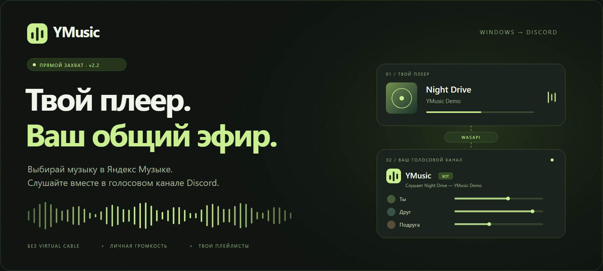
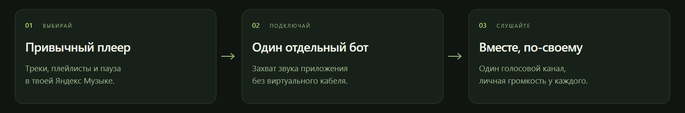
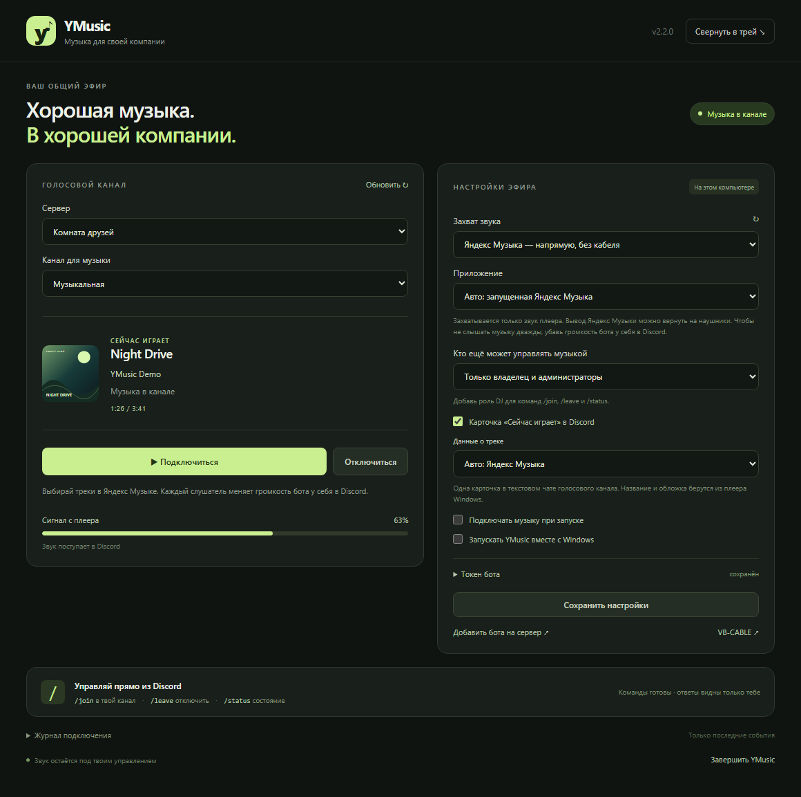

<div align="center">
  
  <br><br>
  <a href="https://github.com/atolife/ymusic-discord/releases/latest"></a>
  <br><br>
  <a href="https://github.com/atolife/ymusic-discord/actions/workflows/ci.yml"></a>
  <a href="https://github.com/atolife/ymusic-discord/releases"></a>
  <a href="LICENSE"></a>
  
  <br><br>
  <b>Русский</b> · <a href="docs/README.en.md">English</a> · <a href="docs/SETUP.md">Настройка</a> · <a href="docs/DEVELOPMENT.md">Для разработчиков</a>
</div>

<br>

**YMusic передаёт музыку из твоего настольного плеера в голосовой канал Discord.** Ты выбираешь треки, ставишь паузу и меняешь плейлисты в Яндекс Музыке. Друзья слышат отдельного бота и регулируют его громкость каждый у себя.

В прямом режиме виртуальный аудиокабель не нужен. Приложение работает локально на твоём Windows-компьютере и использует твоего Discord-бота.



## Музыка остаётся под твоим управлением

| | |
| --- | --- |
| **🎧 Только звук плеера**<br>WASAPI захватывает процесс Яндекс Музыки и его дочерние процессы. Общий звук компьютера автоматически не подставляется. | **🎚 У каждого своя громкость**<br>Бот — отдельный участник канала. Любой слушатель может настроить его громкость лично для себя. |
| **🟢 Видно, что играет**<br>Одна обновляемая карточка с обложкой, исполнителем, паузой и прогрессом. Название трека также появляется в профиле бота. | **🎮 Управление из Discord**<br>`/join`, `/leave` и `/status`. Доступ — владельцу, администраторам и выбранной роли DJ. |
| **↘ Работает в трее**<br>Закрой окно — музыка продолжит играть. Автозапуск и автоматическое подключение включаются по желанию. | **↻ Возвращается после сбоев**<br>Повторные попытки подключения после потери сети, сбоя источника и сна. Ручное отключение отменяет автовозврат. |

## Посмотри, как это выглядит



<sub>Настоящий интерфейс приложения. Трек, сервер и данные подключения на иллюстрации — демонстрационные.</sub>

## Начать за несколько шагов

1. **[Скачай Windows-сборку](https://github.com/atolife/ymusic-discord/releases/latest)** и распакуй ZIP целиком. Запусти `YMusic.exe` из полученной папки. Node.js для готовой сборки не нужен.
2. **[Создай своего Discord-бота](https://discord.com/developers/applications)**, вставь его токен в настройках YMusic и добавь бота на сервер кнопкой в приложении.
3. **Открой настольную Яндекс Музыку**, выбери сервер и голосовой канал, оставь захват **«напрямую, без кабеля»** и нажми **«Подключиться»**.

**[Подробная настройка с разрешениями и пояснениями →](docs/SETUP.md)**

Если слышишь музыку и из плеера, и от бота, поставь громкость бота **у себя в Discord на 0**. Остальные продолжат слышать бота; у тебя останется локальный звук плеера.

## Что потребуется

- **Windows x64** с поддержкой process loopback — build **20348 или новее**. Основной сценарий — Windows 11.
- **Настольное приложение Яндекс Музыки** с доступным воспроизведением.
- Свой **Discord-бот** и права добавить его на сервер.
- Включённый компьютер, работающий плеер и запущенный YMusic на время прослушивания.

Вход в аккаунт Яндекса через YMusic не нужен. Привилегированные Gateway Intents, включая Message Content Intent, не требуются. Настройки и зашифрованный токен остаются на компьютере; аудиозапись на диск не создаётся.

## Пара вещей, которые полезно знать

<details>
<summary><b>Нужен ли Spotify или управление с телефона?</b></summary>

Эта версия создана для настольной Яндекс Музыки на Windows. Управление с телефона и интеграция со Spotify в неё не входят.
</details>

<details>
<summary><b>Можно ли оставить Virtual Cable?</b></summary>

Да. В настройках есть запасной режим **«Аудиоустройство (VB-CABLE)»**. В нём плеер направляется в CABLE Input, а бот читает CABLE Output. Прямой режим работает без этого драйвера.
</details>

<details>
<summary><b>Где появится карточка трека?</b></summary>

В текстовом чате текущего голосового канала. Обновляется одно сообщение на канал. Прогресс — примерно раз в 10 секунд; активность профиля — не чаще раза в 6 секунд. После отключения трансляции дальнейшее личное прослушивание не публикуется.
</details>

<details>
<summary><b>Можно ли пользоваться ботом 24/7 на сервере?</b></summary>

YMusic захватывает звук локального Windows-плеера. Компьютер с плеером должен работать всё время; это не облачный музыкальный бот.
</details>

## Для тех, кто хочет собрать сам

```powershell
git clone https://github.com/atolife/ymusic-discord.git
cd ymusic-discord
npm ci
npm run desktop
```

Нужны Windows x64 и Node.js **22.12+**. Помощник WASAPI соберётся из исходников штатным компилятором .NET Framework.

```powershell
npm run check   # Проверка состава репозитория и известных шаблонов секретов
npm test        # Автоматические тесты
npm run build   # Переносимая Windows-сборка в dist/
```

**[Архитектура и разработка →](docs/DEVELOPMENT.md)** · **[История изменений →](CHANGELOG.md)** · **[Сообщить об ошибке →](https://github.com/atolife/ymusic-discord/issues/new/choose)**

---

Оригинальный код и графика YMusic распространяются по **[MIT](LICENSE)**. Сторонние компоненты сохраняют свои лицензии — см. **[Third-party notices](THIRD_PARTY_NOTICES.md)**. Независимый проект, не связанный с Яндексом или Discord. Учитывай условия музыкального сервиса и права на передаваемое аудио.
