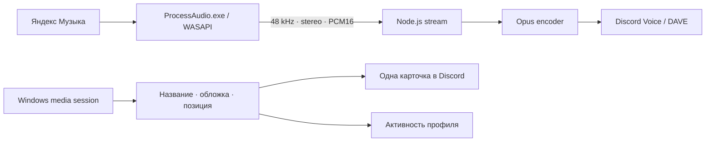

# Разработка

## Локальный запуск

Windows x64, Node.js 22.12+ и стандартный .NET Framework в Windows:

```powershell
npm ci
npm run desktop
```

Первый запуск собирает `native/ProcessAudio.exe`, если помощника нет. Бинарник не хранится в Git. Electron скачивается из официального дистрибутива по зафиксированной версии. Личные настройки и токен для локального запуска не входят в репозиторий.

## Как проходит звук



WASAPI-помощник активирует `VAD\Process_Loopback` с включением дерева целевого процесса. Перед захватом проверяются путь исполняемого файла, PID и время создания процесса; PID ищется заново при переподключении. При паузе выдаются PCM-кадры тишины, чтобы аудиопоток оставался непрерывным. Кольцевой буфер ограничивает накопление задержки.

В запасном режиме FFmpeg читает выбранное DirectShow-аудиоустройство. Оба источника выходят в один формат PCM и используют один транспорт Discord.

## Основные файлы

| Путь | Назначение |
| --- | --- |
| `desktop/main.cjs` | Окно, трей, IPC, сон/пробуждение и запуск сервиса. |
| `desktop/settings.cjs` | Настройки и шифрование Discord-токена средствами Windows. |
| `src/service.js` | Голосовое подключение, команды, доступ и восстановление. |
| `src/process-audio.js` | Обнаружение приложения и адаптер прямого PCM-захвата. |
| `native/ProcessAudio.cs` | WASAPI process-loopback и ограниченный PCM-буфер. |
| `src/media-sessions.ps1` | Чтение медиаданных и обложки через Windows Runtime. |
| `src/now-playing*.js` | Выбор плеера и обновление одного сообщения. |
| `src/activity.js` | Активность бота с объединением частых изменений. |
| `src/audio.js` | Аудиоустройства, FFmpeg и измеритель PCM. |

## Проверки

```powershell
npm run check
npm test
```

Проверяются права команд, отмена ожидающего подключения, бюджет повторных попыток, сон/пробуждение на уровне логики, хранение токена, формат PCM, настоящее кодирование/декодирование Opus, выбор медиасессии, обновление одной карточки и частота обновления активности. Тесты прямого источника используют подставленные списки процессов и не требуют запущенной Яндекс Музыки.

Живое прослушивание, реальное сетевое оборудование и физический сон Windows проверяются отдельно. Проверка известных шаблонов секретов помогает перед публикацией, но не заменяет просмотр diff.

## Сборка и релизы

```powershell
npm run build
powershell -NoProfile -File scripts/archive-release.ps1
```

Результат: `dist/YMusic-<version>-win32-x64/` и архив с SHA-256. Сборщик компилирует WASAPI-помощник из исходников и исключает конфиги, Git, тесты, документационные ресурсы и кэш из приложения. Лицензии зависимостей сохраняются.

Для нового релиза обновите версию в `package.json` и `package-lock.json`, добавьте заметки `docs/releases/v<version>.md` и отправьте тег `v<version>`. Workflow проверяет соответствие тега версии, запускает проверки и сборку, затем публикует ZIP и `SHA256SUMS.txt` в GitHub Releases.

CI на Pull Request имеет только `contents: read`. Право публикации `contents: write` используется только в workflow релиза. Actions закреплены за конкретными коммитами.

## Графика README

Все иллюстрации создаются локально из SVG и настоящего интерфейса с вымышленными данными:

```powershell
npm run docs:assets
npm run docs:render
```

Рендер не подключается к Discord, не читает токены и не захватывает звук. SVG-исходники и PNG находятся в `docs/assets/`. `social-preview.png` — 1280 × 640 для ссылок на репозиторий. `discord-icon.png` — 1024 × 1024; `discord-banner.png` — 680 × 240.

## Ссылки на API

- [Microsoft Application Loopback sample](https://learn.microsoft.com/en-us/samples/microsoft/windows-classic-samples/applicationloopbackaudio-sample/)
- [Windows Media Control](https://learn.microsoft.com/en-us/uwp/api/windows.media.control)
- [Discord Voice](https://discord.js.org/docs/packages/voice/stable)
- [Discord Gateway presence](https://docs.discord.com/developers/events/gateway-events#update-presence)
- [Electron](https://www.electronjs.org/docs/latest/)
