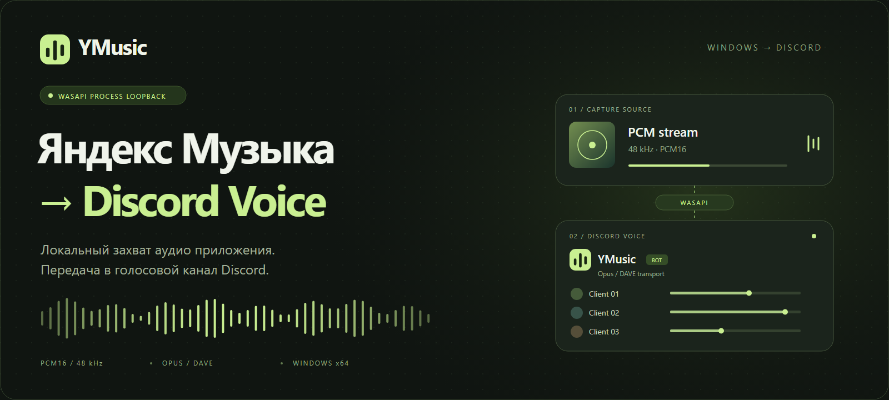
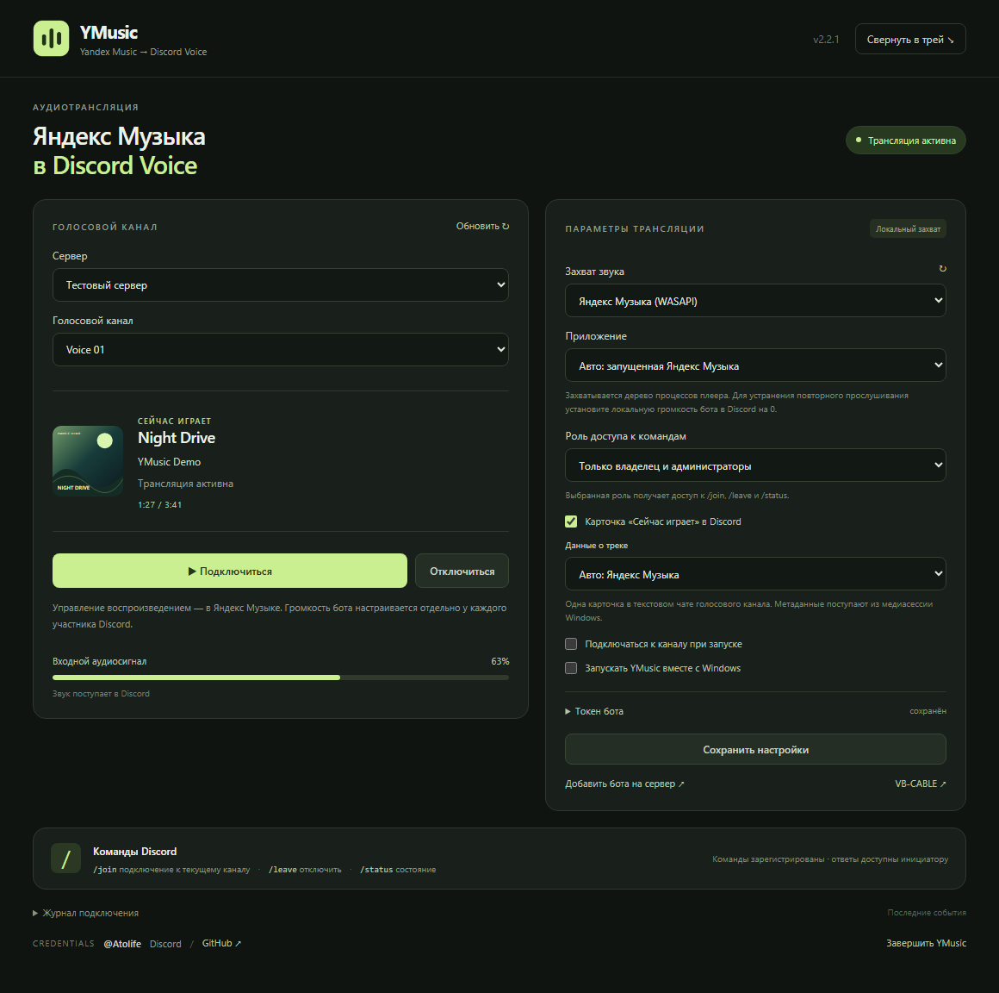

<div align="center">
  
  <br><br>
  <a href="https://github.com/atolife/ymusic-discord/releases/latest"><b>Download Windows x64</b></a>
  <br><br>
  <a href="../README.md">Русский</a> · <b>English</b> · <a href="SETUP.md">Configuration</a> · <a href="DEVELOPMENT.md">Development</a>
</div>

## Overview

**YMusic is a local Windows audio bridge between the Yandex Music desktop application and Discord Voice.** WASAPI process loopback captures the player's process tree. A dedicated Discord bot transmits the audio. Playback remains controlled by the desktop player; participants adjust the bot's volume independently in Discord.

## Capabilities

| Component | Implementation |
| --- | --- |
| Audio source | Process-tree capture with executable path, PID and creation-time validation. |
| Audio transport | PCM16, 48 kHz, stereo → Opus → Discord Voice with DAVE. |
| Track metadata | Title, artist, artwork, playback state and position from Windows media sessions. |
| Discord output | One updated message in the voice-channel text chat and a text activity on the bot profile. |
| Commands | `/join`, `/leave`, `/status`; owner, administrator and configured DJ-role access. |
| Background operation | System tray, optional Windows startup and automatic connection. |
| Recovery | Bounded retries after network or audio failures and Windows sleep. |
| Alternative source | DirectShow audio capture through FFmpeg, including VB-CABLE. |

## Interface



<sub>Interface screenshot using demonstration metadata. No token or personal settings are used.</sub>

## Installation

1. Download the Windows x64 ZIP from [Releases](https://github.com/atolife/ymusic-discord/releases/latest), extract the complete archive and run `YMusic.exe`. Node.js is not required for packaged builds.
2. Create a bot in the [Discord Developer Portal](https://discord.com/developers/applications). Store its token in YMusic and add the bot to the server using the invitation button.
3. Start the Yandex Music desktop player. Select the server, voice channel and WASAPI source in YMusic, then connect.

When monitoring the player locally, set the bot's volume to 0 in the local Discord client to avoid delayed duplicate audio. This does not affect other participants. Required permissions are documented in the [configuration guide](SETUP.md).

## Requirements and limitations

- Windows x64 build **20348+** with process-loopback support; Windows 11 is the primary target.
- Yandex Music desktop application and an active local playback session.
- A Discord bot with permission to connect and transmit audio in the target channel.
- The PC, player and YMusic must remain running throughout the session.
- Spotify integration, phone-only control and Stage channels are not supported.
- Missing target processes cause capture to fail; system-wide audio is not used as an automatic fallback.
- Yandex account credentials are not required. The Discord token is stored locally using Windows-backed encryption. Audio recordings are not written to disk.
- Privileged Gateway Intents are not required. Track-card progress updates approximately every 10 seconds; bot activity updates at most once every 6 seconds. New track metadata is not published after disconnection.
- Packaged builds are not digitally signed.

## Build from source

```powershell
git clone https://github.com/atolife/ymusic-discord.git
cd ymusic-discord
npm ci
npm run desktop
```

Windows x64 and Node.js **22.12+** are required. The WASAPI helper is compiled from source using the Windows .NET Framework compiler.

```powershell
npm run check
npm test
npm run build
```

[Architecture](DEVELOPMENT.md) · [Changelog](../CHANGELOG.md) · [Issue tracker](https://github.com/atolife/ymusic-discord/issues/new/choose)

## Discord assets

[Icon 1024 × 1024](assets/discord-icon.png) · [Banner 680 × 240](assets/discord-banner.png). PNG format; each file is under 10 MB.

## Credentials

**@Atolife** — Discord / [GitHub](https://github.com/atolife)

## License

Original code and artwork are [MIT licensed](../LICENSE). Dependencies retain the licenses listed in [third-party notices](../THIRD_PARTY_NOTICES.md). Independent project, not affiliated with Yandex or Discord. Audio distribution must comply with the music service's terms and applicable content rights.
